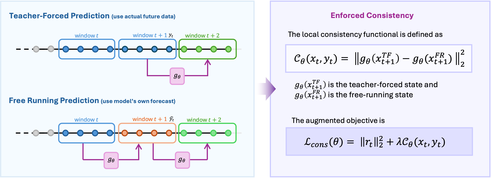
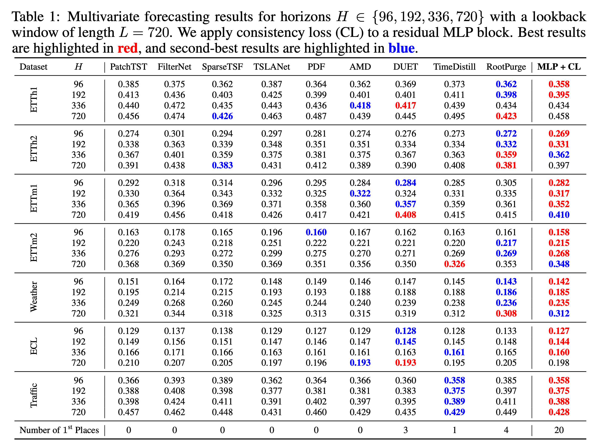
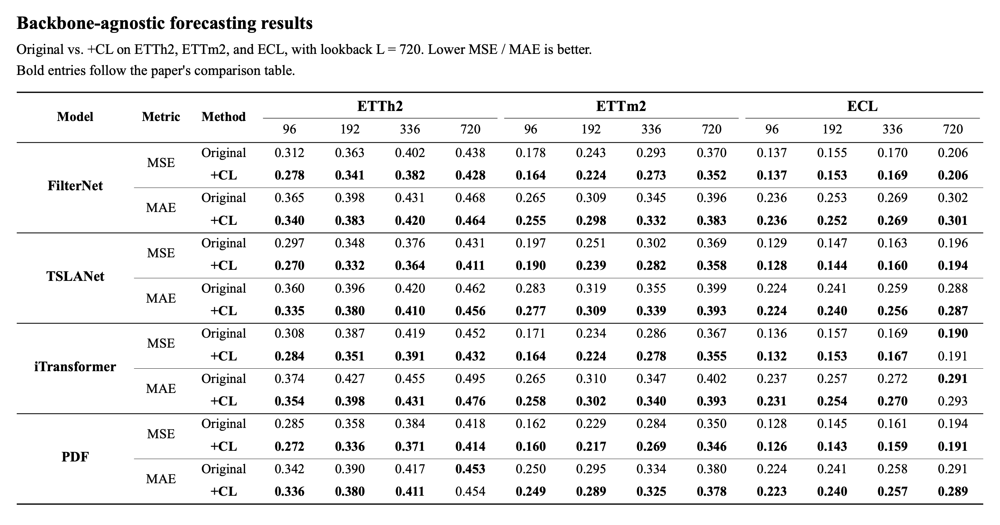
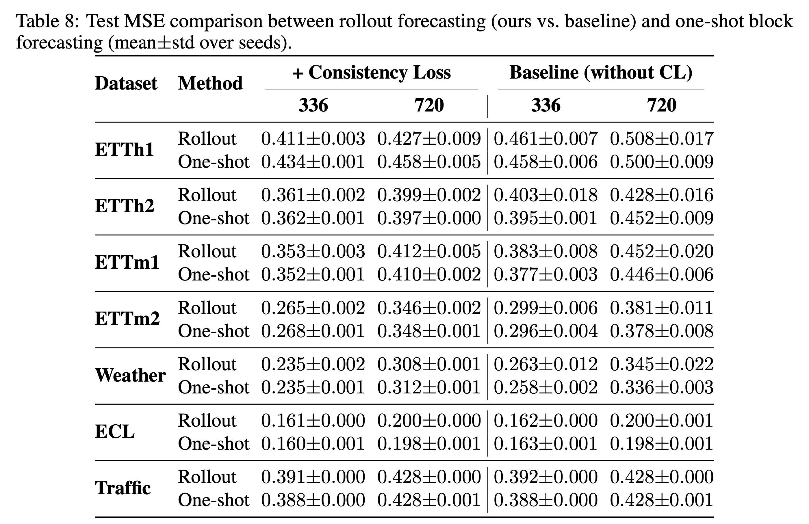

# Consistency Loss

### Echoes of Error: Residual-Directional Local Rollout Consistency for Timeseries Forecasting

**Zheng Wang**, **Kaixuan Zhang**, Xiaonan Lu, Wanfang Chen

Bosch Center for Artificial Intelligence (BCAI)<br>
Bosch (China) Investment Co., Ltd.

Corresponding authors: [Zheng Wang](mailto:david.wang3@cn.bosch.com) and [Kaixuan Zhang](mailto:kaixuan.zhang@cn.bosch.com).

Official implementation of **Consistency Loss (CL)**, a training objective that
reduces a forecaster's sensitivity to its own prediction errors.

## Table of Contents

- [Introduction](#introduction)
- [Method](#method)
- [Main Results](#main-results)
- [Key Properties](#key-properties)
- [Getting Started](#getting-started)
- [Contacts](#contacts)
- [Acknowledgement](#acknowledgement)
- [Citation](#citation)

## Introduction

A forecasting error can affect more than the current prediction. When a model's
output becomes part of a later input, that error can propagate through subsequent
forecasts. Fitting the current target alone does not explicitly control this
feedback effect.

We study **local rollout consistency**: the next forecast should remain similar
whether the input window is updated with the observed future or with the model's
own prediction. This leads to a practical regularizer that penalizes the model's
response along residual-induced perturbations.

The paper connects three perspectives:

1. **Local consistency:** compare teacher-forced and free-running predictions.
2. **Residual sensitivity:** approximate that discrepancy using a Jacobian-vector
   product (JVP) along the forecast residual.
3. **Rollout stability:** under the paper's geometric and residual-excitation
   assumptions, controlling these directions helps keep free-running trajectories
   near a predictive manifold.



*The idealized consistency objective compares predictions from two next-window
states. The practical training loss below uses a local residual-direction surrogate.*

## Method

### 1. Local Rollout Consistency

Let $g_\theta$ map a history window $x_t$ to a future block
$\hat y_t=g_\theta(x_t)$, with residual $r_t=y_t-\hat y_t$.
If $S$ constructs the next history window, the teacher-forced and free-running
states are $S(x_t,y_t)$ and $S(x_t,\hat y_t)$. Their prediction discrepancy is

$$
\mathcal C_\theta(x_t,y_t)
=\left\|g_\theta\!\left(S(x_t,y_t)\right)
-g_\theta\!\left(S(x_t,\hat y_t)\right)\right\|_2^2.
$$

### 2. Practical Residual-Directional Regularization

Constructing a complete next window can be ambiguous when the history and
forecast have different lengths. The practical objective instead inserts the
residual into the input coordinates and penalizes its directional response:

$$
\mathcal L_{\mathrm{CL}}(\theta)
=\|y_t-g_\theta(x_t)\|_2^2
+\lambda\left\|Jg_\theta(x_t)\,\mathrm{sg}[P_\omega r_t]\right\|_2^2.
$$

Here, $P_\omega$ represents zero-padding and residual placement, and
$\mathrm{sg}$ denotes stop-gradient. Sampling the placement probes sensitivity
across the history window. The JVP is computed without constructing the full
Jacobian, while retaining gradients to the model parameters.

For nonlinear predictors, this is a **local surrogate** for the exact consistency
discrepancy. For a linear predictor, the Jacobian is the weight matrix, giving a
residual-response penalty related to RootPurge. Standard one-shot inference
remains unchanged.

### 3. ResMLP and Other Backbones

Our main model is a **residual MLP**: a three-layer, bias-free MLP with ReLU
activations and hidden width 2048, plus a learned linear shortcut. CL is applied
to the two branches separately using a shared forecast residual. The main
experiments fix the linear-branch coefficient at $0.5$ and select the MLP-branch
coefficient from $\{0,0.5,2,8,32,128\}$.

The same objective can also regularize **FilterNet, TSLANet, iTransformer, and
PDF**, using the backbone experiment launcher described below.

## Main Results

### One-Shot Forecasting

The paper's main forecasting table compares ResMLP + CL with nine baselines.
The reported setting uses a lookback of **720** and directly predicts the entire
target horizon. Values are **test MSE**; lower is better. 

[](assets/main_results.png)

*Click the table to view it at full resolution.*

Across the baselines in the paper's main table, ResMLP + CL achieves the lowest
reported MSE in **20 of 28 settings**, including **3 ties at the displayed
precision**.

### Backbone-Agnostic Results

We also apply CL to **FilterNet, TSLANet, iTransformer, and PDF** on
**ETTh2, ETTm2, and ECL**, using a lookback of **720** and forecasting horizons
**96, 192, 336, and 720**. The table compares each backbone's original objective
with CL regularization on **MSE and MAE**. All forecasts are produced in one shot.

[](assets/backbone_results.png)

*Click the table to view it at full resolution.*


Use [`run_script/run_backbone.py`](run_script/run_backbone.py) for these
experiments; model-specific settings are in
[`run_script/experiment_settings.py`](run_script/experiment_settings.py).

### Recursive Forecasting

The rollout experiment trains at horizon **96** with lookback **720**, then feeds
predictions back into the context to reach horizons **336 and 720**. The table
below reports **test MSE (mean ± standard deviation)** for recursive forecasts
and separately trained one-shot references, with and without CL.

[](assets/recursive_forecasting.png)

*Click the table to view it at full resolution.*


## Getting Started

### Environment Setup

Run the following from the repository root. The GPU environment uses Python 3.9
and PyTorch 2.2.2:

```bash
conda create -n timeseries python=3.9 pytorch==2.2.2 torchvision==0.17.2 torchaudio==2.2.2 pytorch-cuda=12.1 numpy=1.26.0 -c pytorch -c nvidia
conda activate timeseries
pip install -r requirements.txt
```

The forecasting entry point configures its own import paths. CUDA is selected
automatically when available; use `--device cpu` on the direct runner for CPU
execution. Full benchmark experiments are intended for a GPU.

### Datasets

Prepare the standard benchmark CSV files in this layout (datasets and trained
checkpoints are not included):

```text
datasets/time_series/
├── ETT-small/
│   ├── ETTh1.csv
│   ├── ETTh2.csv
│   ├── ETTm1.csv
│   └── ETTm2.csv
├── electricity/electricity.csv
├── traffic/traffic.csv
└── weather/weather.csv
```

CSV files must contain a `date` column and numeric time-series columns. Keep the
standard benchmark column names, including `OT`. The loaders apply chronological
train/validation/test splits and fit normalization on the training split only.
`--data-root` below points to `datasets/time_series`, not an individual CSV folder.

### ResMLP experiments

ResMLP uses `--model mlp_nobias` with `--val_type branch_res`. Its batch
experiments are defined in `run_resmlp_best.sh` and `run_resmlp_sweep.sh`;
`run_backbone.py` is reserved for the other forecasting backbones.

Run one ETTh1 experiment:

```bash
python -u consistency_loss/run_forecasting_res_nl.py \
  --task_name long_term_forecast --is_training 1 \
  --root_path datasets/time_series/ETT-small --data_path ETTh1.csv \
  --model_id ETTh1 --data ETTh1 --features M \
  --model mlp_nobias --val_type branch_res --decouple_checker decouple \
  --seq_len 720 --label_len 0 --pred_len 96 \
  --enc_in 7 --dec_in 7 --c_out 7 \
  --batch_size 128 --d_model 2048 --depth 3 --dropout 0 \
  --learning_rate 5e-4 --train_steps 5000 --seed 2021 \
  --individual False --regu_coef 0.5 --regu_coef_mlp 32
```

For the complete main-experiment configurations:

```bash
DATA_ROOT=/absolute/path/to/datasets/time_series bash run_script/run_resmlp_best.sh
```

Use `run_script/run_resmlp_sweep.sh` instead for the ResMLP regularization sweep.


### Backbone comparisons

`run_script/run_backbone.py` only runs FilterNet, TSLANet, iTransformer, and PDF
on ETTh2, ETTm2, and ECL. It prints commands by default. Inspect the plan,
then append `--execute` to run it sequentially. Restrict a sweep using
`--datasets`, `--models`, `--pred-lens`, `--seeds`, or `--lambdas` as applicable.
Select coefficients using validation MSE, not test MSE.

```bash
python run_script/run_backbone.py \
  --data-root datasets/time_series \
  --models FilterNet TSLANet iTransformer pdf \
  --datasets ETTh2 ETTm2 ECL --checker-sizes 0
```

Hyperparameters are in `run_script/experiment_settings.py`. 

`--checker-sizes 0` uses full-batch JVP; `--checker-sizes 1 2` evaluates sampled
JVP. TSLANet/ECL uses physical batch 32 for full JVP and 64 for sampled JVP.
Set `--batch-size` explicitly to use the same physical batch in comparisons.

### JVP batch subsampling

For ResMLP, append the following to the single-experiment command above to
compute the consistency penalty on 1/16 of each batch:

```text
--checker_batch_ratio 0.0625
```

The prediction MSE always uses the full batch. Only the JVP penalty is
subsampled; both MLP and linear branches use the same sampled rows.

On the direct runner, `--checker_batch_ratio` selects
`ceil(actual_batch_size * ratio)` rows (at least one).
A positive `--checker_batch_size` overrides the ratio; size 0 uses the ratio.
The defaults (ratio 1, size 0) use full-batch JVP. The penalty is averaged over
the subset without an additional batch-size multiplier.


### ResMLP rollout stability

Use the direct forecasting entry point for rollout experiments. Append the
following to the single ResMLP experiment above (which trains at horizon 96):

```text
--test_pred_lens 336 720
```

This trains one horizon-96 model and recursively evaluates it at 336 and 720.
For one-shot references, run separate experiments with `--pred_len 336` and
`--pred_len 720`, omitting `--test_pred_lens`. 

To evaluate an existing checkpoint, reuse its model/data/architecture arguments
on the direct runner and set:

```text
--is_training 0 --load_ckpt /path/to/checkpoint.pth --test_pred_lens 336 720
```

Keep `--pred_len` equal to the checkpoint's training horizon (96 in this example).


### Code layout

- `run_script/experiment_settings.py`: backbone hyperparameters.
- `run_script/run_backbone.py`: backbone experiment grids and command generation.
- `run_script/run_resmlp_best.sh`: ResMLP runs with configured CL coefficients.
- `run_script/run_resmlp_sweep.sh`: ResMLP CL coefficient sweep.
- `consistency_loss/run_forecasting_res_nl.py`: model/data setup, training, and evaluation.
- `consistency_loss/residual_check_general.py`: consistency losses and JVP sampling.
- `consistency_loss/rollout.py`: recursive forecasting and metrics.
- `consistency_loss/experiment_utils.py`: run identifiers and result files.
- `genTS/backbones/`: FilterNet (`PaiFilter.py`), TSLANet, PDF, and iTransformer used in the backbone experiments.
- `genTS/`: backbone implementations, data loaders, and supporting modules.

## Contacts

For questions about the method or experiments, please open an issue or contact
[Zheng Wang](mailto:david.wang3@cn.bosch.com) and
[Kaixuan Zhang](mailto:kaixuan.zhang@cn.bosch.com).

## Acknowledgement

We thank the authors and maintainers of the forecasting models and benchmark
datasets used in this work, including Time-Series-Library, ETT, FilterNet,
TSLANet, iTransformer, PDF, and the other baselines evaluated in the paper.
This work also builds on the analysis of linear forecasting and residual
regularization in [RootPurge](https://github.com/Wangzzzzzzzz/RootPurge).

## Citation

If you find this work useful, please cite our paper:

```bibtex
@inproceedings{wang2026echoes,
  title = {Echoes of Error: Residual-Directional Local Rollout Consistency for Timeseries Forecasting},
  author = {Zheng Wang and Kaixuan Zhang and Xiaonan Lu and Wanfang Chen},
  booktitle = {The Fortieth Annual Conference on Neural Information Processing Systems},
  year = {2026},
  url = {https://openreview.net/forum?id=UjSZdUySXj}
}
```
